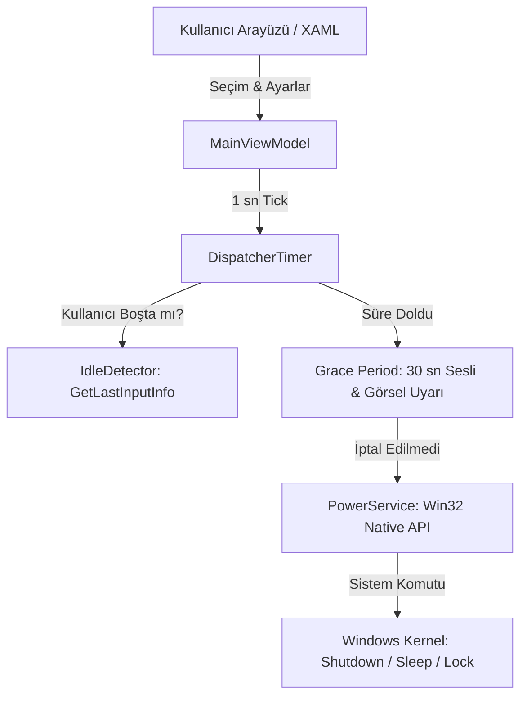

# 🏛️ ChronoPower Mimari Tasarımı (ARCHITECTURE.md)

ChronoPower, Windows üzerinde çalışan modern, düşük kaynak tüketimli ve tip güvenli bir güç yönetimi asistanıdır.

---

## 🧩 Katmanlar ve Sorumluluklar

```
ChronoPower/
├── Views/ (Presentation)
│   ├── App.xaml / App.xaml.cs          # Uygulama yaşam döngüsü, tekil örnek (single-instance) kontrolü
│   └── MainWindow.xaml / .cs           # Fluent UI arayüzü, pencere efektleri, sistem tepsisi (Tray)
├── ViewModels/ (Presentation Logic)
│   ├── MainViewModel.cs               # Sayaç döngüsü, kullanıcı seçimleri, durum yönetimi
│   ├── ViewModelBase.cs               # INotifyPropertyChanged altyapısı
│   └── RelayCommand.cs                # ICommand arayüz komut bağlayıcısı
├── Models/ (Domain)
│   ├── PowerAction.cs                 # Kapat, Uyku, Yeniden Başlat, Hazırda Beklet, Kilitle eylemleri
│   └── ScheduleMode.cs                # Geri Sayım, Belirli Saat, Boşta Kalma (Idle) modları
├── Services/ (Infrastructure / Interop)
│   ├── IPowerService / PowerService   # Windows Win32 API çağrıları (ExitWindowsEx, SetSuspendState, LockWorkStation, WaitableTimer)
│   ├── IdleDetector.cs                # Win32 GetLastInputInfo ile sistem boşta kalma tespiti
│   └── AppIconGenerator.cs            # Dinamik tepsi simgesi ve durum görselleştirmesi
└── Converters/
    └── BoolToVisibilityConverter.cs   # WPF XAML görünürlük dönüşümleri
```

---

## ⚡ Veri Akışı ve Tetikleme Döngüsü



---

## 🛡️ Dokunulmaz Kurallar (Invariants)
1. **Güvenli Güç Yönetimi:** Kullanıcının verisini kaybetmemesi için son aşamada daima iptal edilebilir bir "Grace Period" çalıştırılır.
2. **Win32 P/Invoke İzolasyonu:** Doğrudan Win32 çağrıları (`user32.dll`, `powrprof.dll`, `kernel32.dll`) yalnızca `Services/` katmanında tutulur, ViewModel veya View doğrudan işletim sistemi API'si çağırmaz.
3. **Tekil Örnek (Single Instance):** Uygulama ikinci kez çalıştırıldığında mevcut pencere öne getirilir, birden fazla zamanlayıcı çakışması engellenir.
